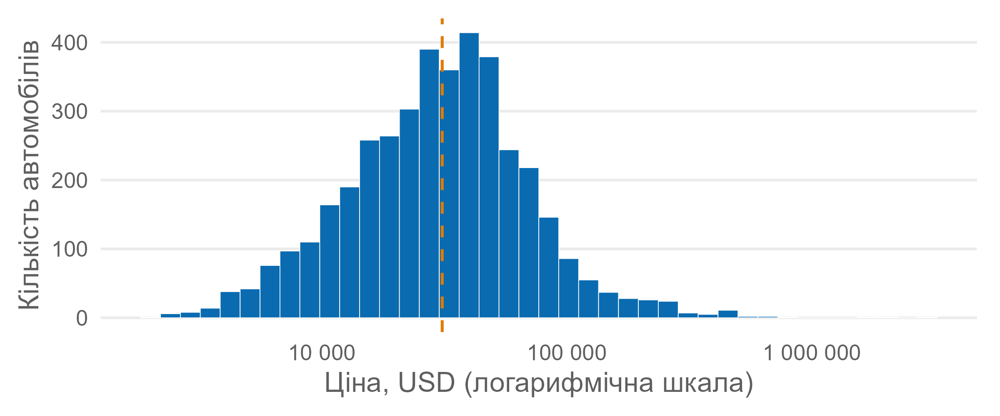
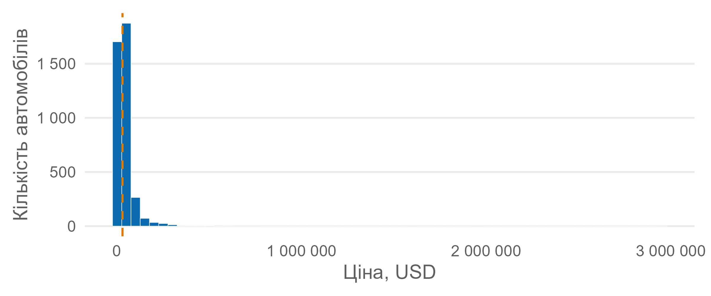
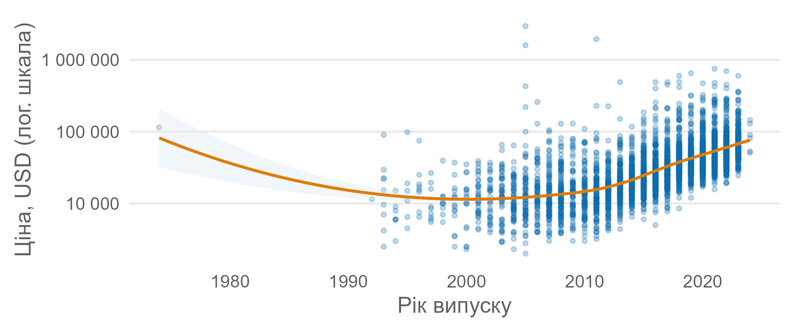
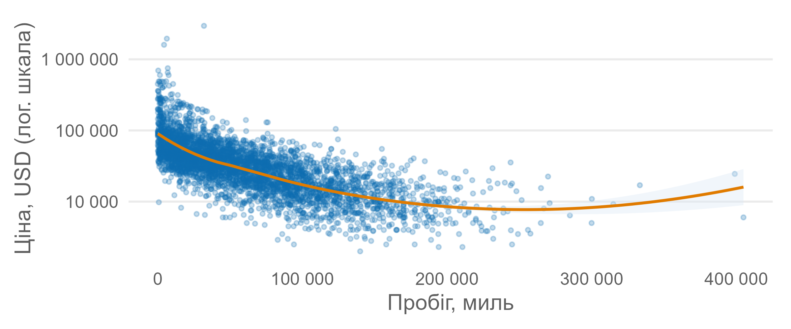
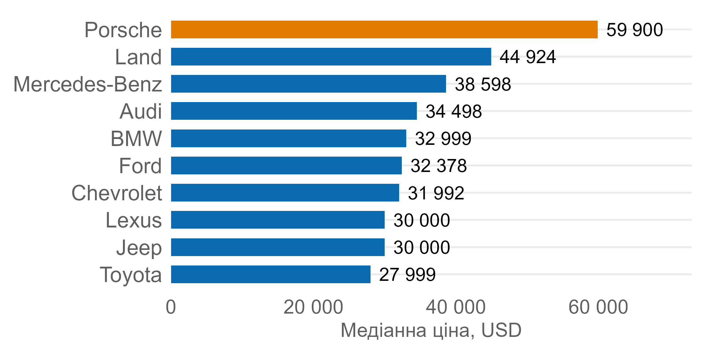
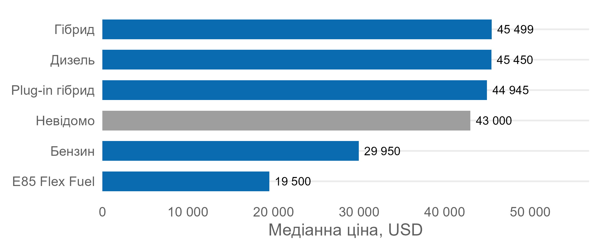
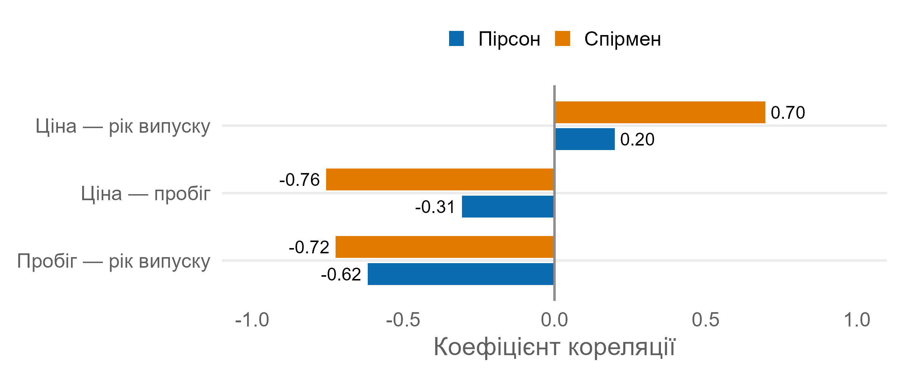
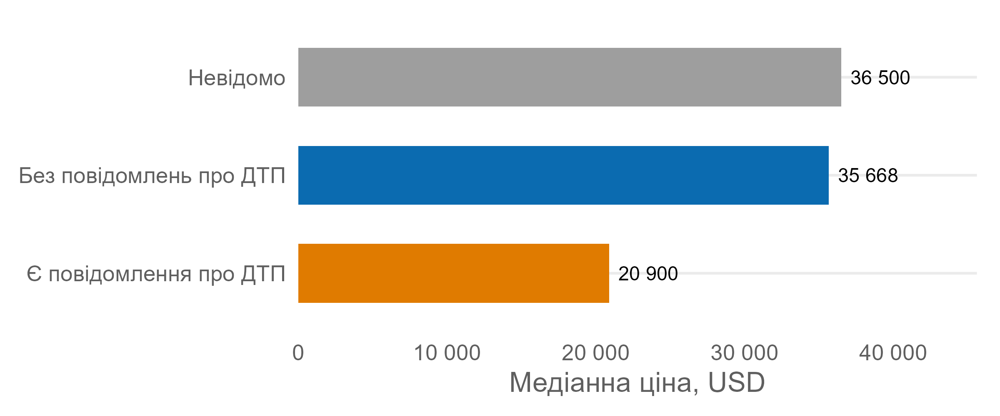
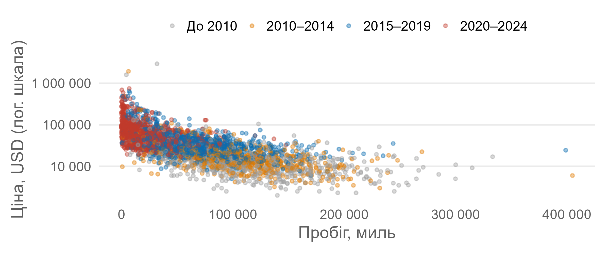
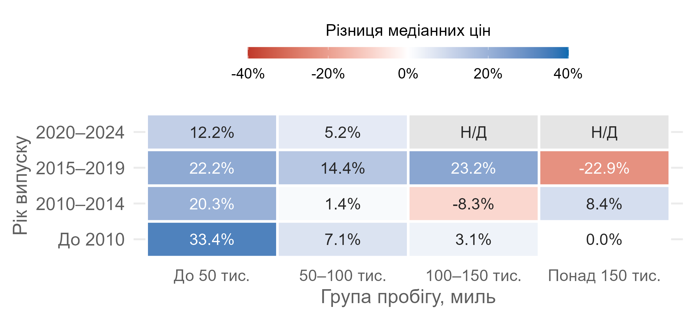

---
title: "Аналіз вартості вживаних автомобілів"
subtitle: "Лабораторна робота №2 — розвідувальний аналіз даних (EDA)"
author: "Каламаж Володимир, АтаВДвR-11"
lang: uk
format:
  revealjs:
    theme: [default, style.scss]
    width: 1280
    height: 720
    margin: 0.05
    center: false
    transition: none
    slide-number: "c/t"
    progress: false
    controls: false
    hash: true
    embed-resources: true
execute:
  echo: false
  warning: false
  message: false
---

## Мета та дослідницькі запитання

Дослідити розподіл цін вживаних автомобілів та їхній зв’язок із характеристиками автомобілів.

1. Як розподіляються ціни вживаних автомобілів?
2. Як рік випуску пов'язаний із ціною автомобіля?
3. Чи існує зв'язок між пробігом і ціною?
4. Як відрізняються ціни залежно від марки та типу пального?
5. Як пов'язані з ціною історія ДТП, рік випуску та пробіг при спільному аналізі?

## Датасет містить 4 009 автомобілів

| Характеристика | Значення |
|:---|---:|
| Кількість спостережень | 4 009 |
| Кількість змінних | 12 |
| Числові змінні | 3 |
| Категоріальні змінні | 9 |
| Найстаріший рік випуску | 1974 |
| Найновіший рік випуску | 2024 |

::: key
Основні змінні аналізу: ціна, пробіг, рік випуску, марка, тип пального та історія ДТП.
:::

::: source-note
Джерело: [Used Car Price Prediction Dataset, Kaggle](https://www.kaggle.com/datasets/taeefnajib/used-car-price-prediction-dataset/data).
:::

## Очищення дозволило зберегти всі спостереження

| Показник | До очищення | Після очищення |
|:---|---:|---:|
| Кількість спостережень | 4 009 | 4 009 |
| Кількість змінних | 12 | 12 |
| Пропуски в clean_title | 596 | 0 |
| Пропуски у fuel_type | 170 | 0 |
| Пропуски в accident | 113 | 0 |
| Повні дублікати | 0 | 0 |

::: key
Пропуски замінено категорією Unknown, ціну та пробіг перетворено на числовий формат. Потенційні викиди збережено.
:::

::: source-note
Джерело: власні розрахунки за результатами очищення даних.
:::

## Медіанна ціна становить 31 000 USD

::: figure-area
{height=400px}
:::

::: key
Половина автомобілів коштує не більше 31 000 USD. Помаранчева лінія позначає медіану.
:::

::: source-note
Джерело: Used Car Price Prediction Dataset, власні розрахунки (n = 4 009).
:::

## Розподіл цін має правосторонню асиметрію

::: figure-area
{height=400px}
:::

::: key
Середня ціна — 44 553 USD, медіанна — 31 000 USD. Коефіцієнт асиметрії становить приблизно 19,5.
:::

::: source-note
Джерело: Used Car Price Prediction Dataset, власні розрахунки (n = 4 009).
:::

## Новіші автомобілі зазвичай коштують дорожче

::: figure-area
{height=400px}
:::

::: key
Між роком випуску та ціною спостерігається позитивний монотонний зв'язок: ρ Спірмена = 0,697.
:::

::: source-note
Джерело: власні розрахунки (n = 4 009). Лінія — згладжування LOESS.
:::

## Зі збільшенням пробігу ціна зазвичай знижується

::: figure-area
{height=400px}
:::

::: key
Пробіг має виражений негативний монотонний зв'язок із ціною: ρ Спірмена = −0,755.
:::

::: source-note
Джерело: власні розрахунки (n = 4 009). Лінія — згладжування LOESS.
:::

## Porsche має найвищу медіанну ціну серед популярних марок

::: figure-area
{height=440px}
:::

::: key
Серед десяти найпоширеніших марок Porsche має найвищу медіанну ціну — 59 900 USD.
:::

::: source-note
Джерело: власні розрахунки. Марки відібрано за кількістю спостережень.
:::

## Медіанні ціни відрізняються за типами пального

::: figure-area
{height=400px}
:::

::: key
Медіанна ціна гібридних автомобілів становить 45 499 USD, бензинових — 29 950 USD.
:::

::: source-note
Джерело: власні розрахунки. Кількість спостережень у групах неоднакова.
:::

## Коефіцієнти Спірмена більші за модулем

::: figure-area
{height=400px}
:::

::: key
Для всіх трьох пар змінних абсолютні значення кореляції Спірмена перевищують значення кореляції Пірсона.
:::

::: source-note
Джерело: власні розрахунки за початковими числовими значеннями (n = 4 009).
:::

## Автомобілі з історією ДТП мають нижчу медіанну ціну

::: figure-area
{height=400px}
:::

::: key
Медіанна ціна авто з повідомленнями про ДТП або пошкодження на 41,4% нижча, ніж у авто без таких повідомлень.
:::

::: source-note
Джерело: власні розрахунки. Порівняно групи з відомою історією ДТП.
:::

## Рік випуску та пробіг пов'язані з ціною

::: figure-area
{height=400px}
:::

::: key
Новіші автомобілі переважно мають менший пробіг і вищу ціну. Характеристики необхідно розглядати спільно.
:::

::: source-note
Джерело: власні розрахунки (n = 4 009). Колір позначає групу року випуску.
:::

## Різниця цін за історією ДТП неоднакова в різних групах

::: figure-area
{height=390px}
:::

::: key
Позитивні значення означають нижчу медіанну ціну автомобілів із ДТП, негативні — вищу.
:::

::: source-note
Джерело: власні розрахунки. Мінімум 10 спостережень у кожній категорії ДТП. Н/Д — недостатньо даних.
:::

## Підсумкові висновки та обмеження

**Основні висновки**

- Медіанна ціна становить 31 000 USD, розподіл має правосторонню асиметрію.
- Ціна позитивно пов'язана з роком випуску та негативно — з пробігом.
- Медіанні ціни відрізняються за марками, типами пального та історією ДТП.
- Спільний аналіз показує неоднорідність зв'язків між характеристиками.

**Обмеження дослідження**

- Нерівномірна представленість категорій, невідомі значення та потенційні викиди.
- Відсутність контролю всіх можливих чинників ціноутворення.
- Виявлені статистичні зв'язки не доводять причинно-наслідкових залежностей.
- Вибірка не обов'язково репрезентує весь ринок вживаних автомобілів.